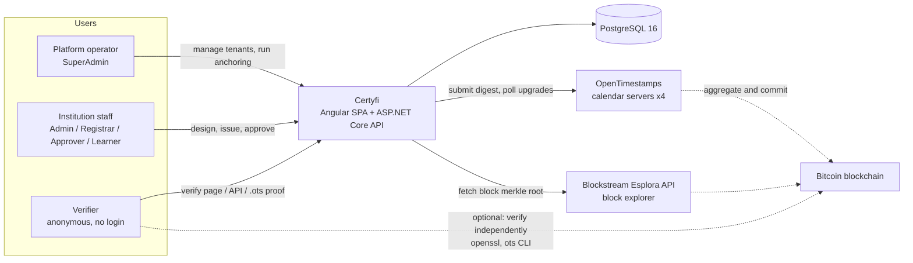
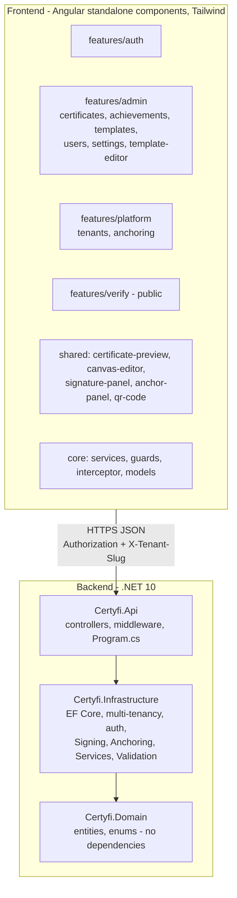
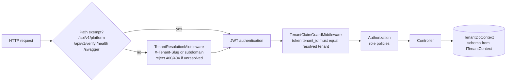
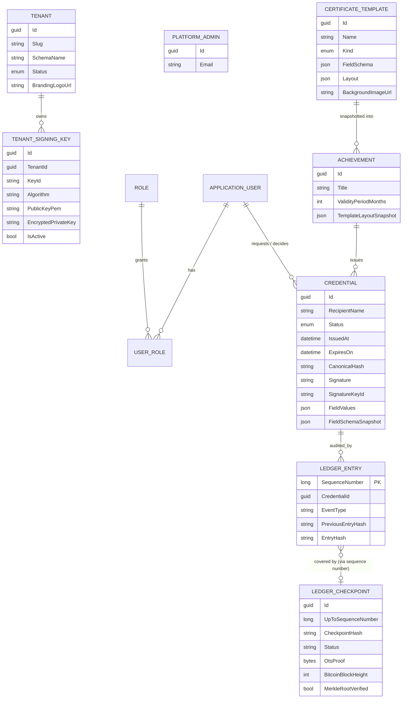
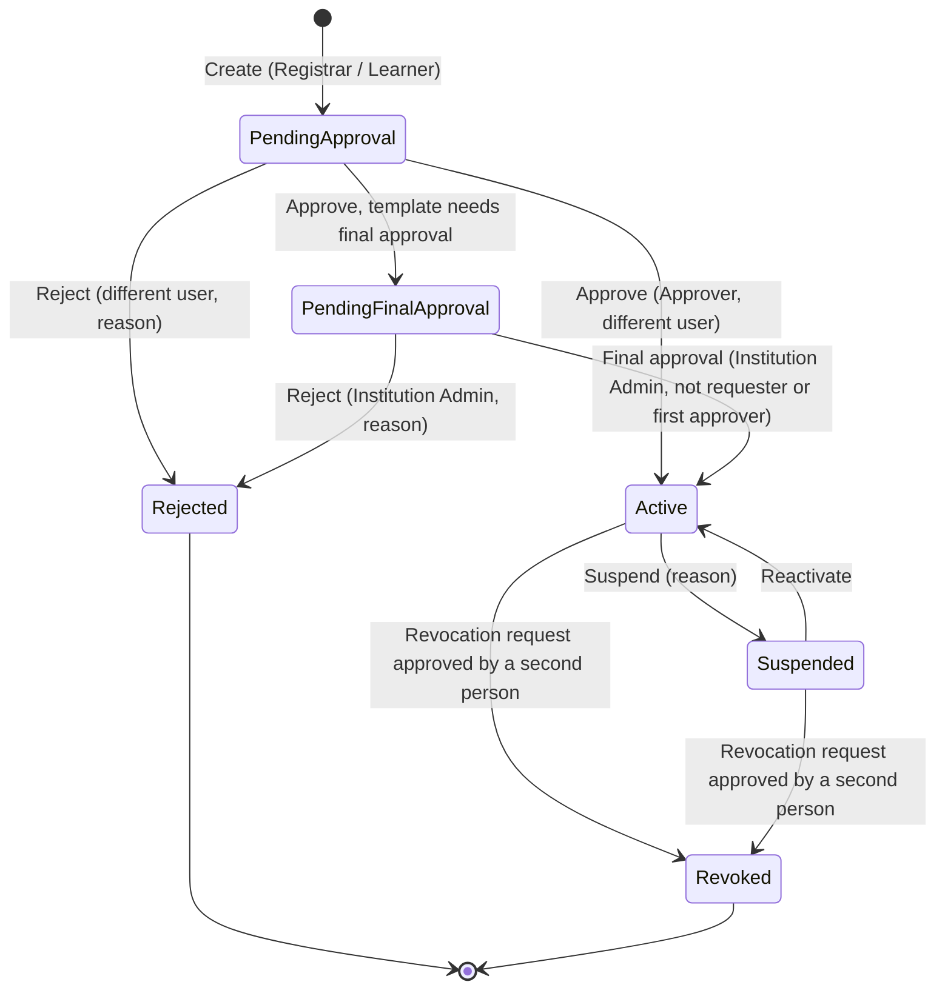
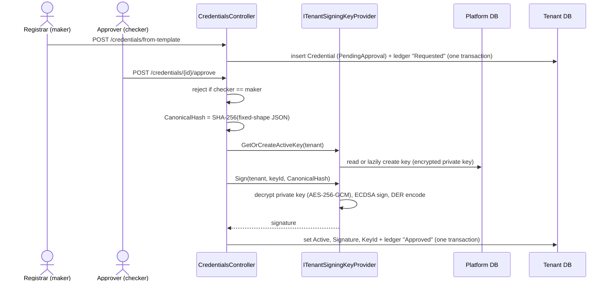
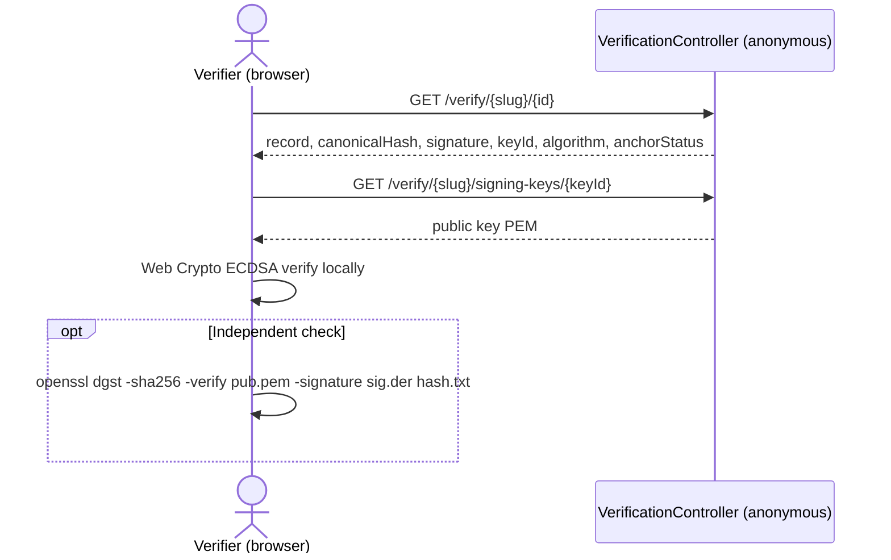
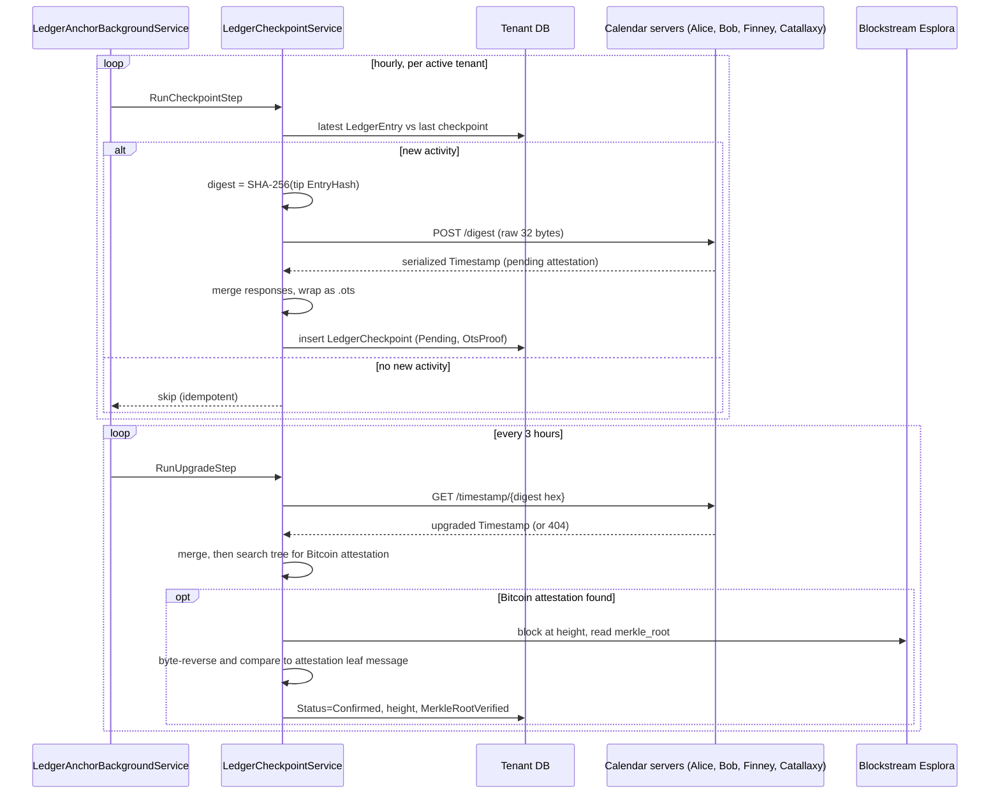
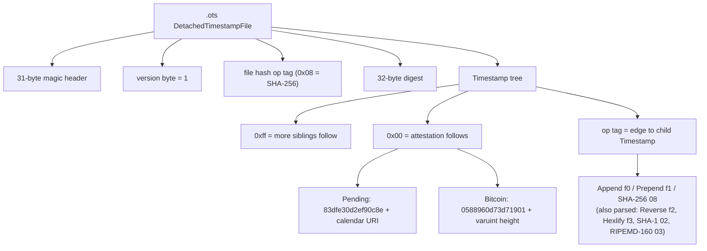

# Certyfi — Technical Architecture & Scope

**Audience:** engineers and technical reviewers.
**Status:** reflects the code as of 2026-09-26. Diagrams are Mermaid and render
on GitHub and in VS Code's Markdown preview.

Related: `technical-approach-summary.md` (decisions), `test-plan-signing-anchoring.md`
(verification steps), `partner-api.md` (Partner API integration guide), `brochure.md` (client-facing summary).

---

## 1. Purpose and scope

Certyfi is a multi-tenant platform through which institutions design, issue,
manage and publicly verify digital certificates and transcripts. Its defining
properties are that issuance needs two different people (maker–checker; three
when a template needs final approval by an institution admin), and
that authenticity does not depend on trusting Certyfi: each certificate is
signed under its institution's own key, and the audit ledger is anchored to
Bitcoin.

### In scope (built)

| Area | Capability |
|---|---|
| Tenancy | Schema-per-tenant PostgreSQL, tenant resolution, tenant-claim guard, SuperAdmin provisioning |
| Identity & access | JWT auth, 7 roles, role-scoped endpoints and UI routes |
| Templates | Visual canvas designer, imported background images (local uploads), size presets, two legacy fixed layouts |
| Credentials | Draft → approve/reject → active → suspend/reactivate (one person) or revoke (two-person request → approve), on a separate Revoke & suspend page with the certificate code typed to confirm; custom field schemas; expiry computed live |
| Personal data and the audit trail | Names, emails and free-text reasons are kept beside the hash chain (`ledger_entry_details`), and each chained entry holds only a salted fingerprint of them (HMAC-SHA256 with the certificate's own salt). The integrity check verifies both. Erasure on request (`POST /credentials/{id}/erase-personal-data`, Institution Admin, revoked or rejected certificates, code typed) deletes the details and the salt and scrubs the certificate; the chain stays intact and the certificate stops resolving publicly. The signed canonical hash also includes the salt. Entries written before this change still hold personal data in the chain |
| Private home page | The home page (presentation) needs a pass: visitors enter a mobile number at `/access` (`POST /api/v1/access`, rate-limited per IP; matched as typed or by its last 10 digits) and get a signed 30-day HttpOnly cookie if it's on the platform operator's list (`/api/v1/platform/home-access`, SuperAdmin). The shared reverse proxy checks it (`auth_request` to `GET /api/v1/access`) before serving `/` and `/assets/presentation/`, which are sent `no-store`; the app's route guard covers in-app navigation. Verification, logins and the Partner API are not gated. No SMS code: a number works like a shared password |
| Paper certificate import | Spreadsheet (CSV/.xlsx) → column mapping → dry run → chunked import as one batch → a different approver approves the batch (types the count) → signed. Keeps the paper's date and number (both signed; `awardedDate` in Open Badges); IssuedAt is the digitising day. Old numbers verifiable publicly only with the name as printed |
| Audit | Hash-chained, append-only `ledger_entries` (Postgres trigger blocks UPDATE/DELETE) with integrity check |
| Signing | Per-tenant ECDSA P-256 keys, AES-256-GCM at rest, DER signatures, public key endpoint, in-browser verification |
| Anchoring | Periodic ledger checkpoints to Bitcoin via OpenTimestamps; native C# proof parser; downloadable `.ots` proofs; merkle-root check against a block explorer |
| Verification | Public page + anonymous JSON API + QR codes |
| Operations | SuperAdmin console: tenants, on-demand anchoring |
| Partner API | Per-tenant API keys with scopes, managed by Institution Admins; issue/read/revoke credentials; optional auto-issue per key; idempotent retries via `externalReference`; per-key rate limit; template preview links (`POST /partner/templates/{id}/preview-link` → a 15-minute HMAC-signed `/template-preview/{token}` page drawing the template with sample data, watermarked "Sample", framable by partner apps); OpenAPI docs at `/api/v1/docs` |
| Students and student portal | `students` per tenant (one per email, which is the sign-in; partner `StudentNumber` unique; editable by staff or by a partner sending a known `studentId` with new details, each change in `student_changes`, old address notified, issued certificates unchanged), linked from every certificate with an email (`CredentialIssuanceService` finds or creates; existing certificates backfilled by the AddStudentPortal migration; erasure removes a student left with no certificates). Students sign in at `/student/<code>` with their own JWT (role `Student`, accepted by no staff endpoint; `/api/v1/student-portal`). First sign-in via a 30-day HMAC-signed set-up link, forgot-password via a 1-hour reset link (`StudentPortalLink`: slug, purpose, student, sign-in version, expiry; set-up links die once a password is set, reset links once used, all when staff reset), emailed to the student (never returned to partners). Keys with `RequiresPayment` create certificates as `AwaitingPayment`; the student's dummy payment moves them to `PendingApproval` (ledger event `Paid`), or straight to Active with auto-issue. Unpaid ones get `PaymentDueAt` from the institution's `Tenant.PaymentDays` (default 14, 0 = none); `PaymentDeadlineRunner` (background, every 5 minutes, per tenant) emails one reminder (3 days before, or halfway) and cancels at the deadline (`CancelledForNonPayment`). The requesting key can cancel one that isn't issued yet (`POST /partner/credentials/{id}/cancel` → `Cancelled`, ledger event `Cancelled`, student emailed). Pay, cancel, approve and reject each lock the row and re-check the status inside their transaction, so concurrent ones can't both apply. Staff: `/admin/students` (InstitutionAdmin, Registrar); InstitutionAdmin can email set-up links to everyone not signed up (`POST /students/invitations`, preview first; skips anyone sent a set-up link in the last 7 days via `Student.LastInvitedAt`; the email sender paces Resend at ~2/s) |
| Certificate design | Templates are designed on a canvas (`LayoutJson`, checked by `LayoutValidator`): besides the data elements, institutions add their own `text`, `line` and `image` elements (images uploaded via `/uploads/image`, http(s) only), set type per element (12 fonts, `LayoutValidator.FontKeys`, loaded from Google Fonts; italic, capitals, letter spacing, line height, opacity) and a `frame` drawn by Certyfi (line, double, classic, ornate, corners, ribbon, band). Frames and type are drawn by shared code (`certificate-design/`), so the editor, verify page, PDF and previews match. The editor has undo/redo, snapping guides, arrow-key nudging, layers, lock, duplicate and zoom. A gallery of 8 ready-made designs (`certificate-designs.ts`: Classic, Elegant, Modern, Minimal, Training, Award, Participation, Academic transcript) fills a new template or replaces a template's design; each contains every core item and the template's fields |
| Mandatory certificate content | Every certificate shows the institution (name or logo), recipient name, title, issue date, signatories and its QR code or code: a template's design must contain them (`LayoutValidator.CoreElements`) and name 1–3 signatories before it can be saved. Signatories (`signatories` per tenant: name and designation, no images; `/admin/signatories`, InstitutionAdmin) are chosen per template (`CertificateTemplate.SignatoryIds`, read live) and copied onto each certificate when it is created (`Credential.SignatoriesJson`, part of the canonical hash at approval), so later changes never alter existing certificates. A template without signatories can't make certificates (400 from staff, import and Partner API; paper imports are exempt, the paper carried its own signatures). Designs from before the `signatories` element print them in a band below. Template fields can be marked `required` (non-blank, or ≥1 table row), enforced on every path, including by key on achievements reused from before the flag was set. `Certificates:EnforceMandatoryContent` (default true) switches the signatory and design rules; tests run with it off except `SignatoryTests` |
| Student portal pages and banners | Students reach the portal from the landing page, institution login and verify page via `/student/login` (email and password only) or `/student/<code>/login` (the link in emails). Email-only sign-in (`POST /api/v1/student-sign-in`, not tenant-scoped) finds the institutions where the email is a student through `platform.student_sign_in_index` (keyed HMAC of the email, never the address; `StudentSignInIndex`, kept in step when a student is created, changes email or is erased, rebuilt for every institution by migrate-schemas on each deploy, and re-added at each sign-in), checks the password at each, and signs in where it matches; when it matches at several, the page asks which institution. Unknown email and wrong password get the same 401. `POST /api/v1/student-sign-in/forgot-password` emails a reset (or set-up) link from each institution, always 202. Every student page shares `StudentShell`: the institution's logo and name (`GET /student-portal/institution`, anonymous) and its own banners on either side (below on phones). Banners are images and links only, no third-party ad code: `portal_banners` per tenant (title as alt text, image uploaded via `POST /uploads/image`, optional http(s) link, side, order, optional from/until dates, on/off, click count), managed by InstitutionAdmin at `/admin/portal-banners` (`/api/v1/portal-banners`, 6 per side). Students see active, in-date ones (`GET /student-portal/banners`); a click opens the link in a new tab and adds one to the count (`POST /student-portal/banners/{id}/click`, rate-limited). The certificate list includes each certificate's text fields (labels from the template) and is searched in the browser on title, code, field labels and values, with status and year filters |
| Email | Queued in `platform.email_outbox`, sent by `EmailDispatcher` (background, every `Email:DispatchIntervalSeconds`; claim-then-send so nothing goes twice; retries with backoff up to `Email:MaxAttempts`; bodies deleted once finished; records purged after 90 days; erasure deletes a certificate's and an erased student's records). `Email:Provider`: `Smtp` (Mailpit locally, :1025/:8025), `Resend` (production; outbox id as idempotency key), `None` (recorded as Skipped) or `Memory` (tests). Student emails (`StudentNotifications`): certificate requested, issued, rejected (with reason; refund pointer if paid), cancelled, suspended, reactivated and revoked (no reason quoted) (partner-requested certificates only), staff "email link", forgot password; links need `PublicApp:BaseUrl` |
| Webhooks | Per API key (`WebhookUrl`, secret AES-GCM-encrypted under a master-key-derived key, `SecretProtector`). Every status change of a key's credential queues a `webhook_deliveries` row inside the change's own transaction (`WebhookQueue`); `WebhookDispatcher` (background, every 10 s, per tenant; also queues "Expired" once) claims and POSTs `credential.updated` signed `v1=` HMAC-SHA256(secret, `{ts}.{body}`), 10 s timeout, no redirects, private/internal addresses refused outside development. 2xx delivered; 401/4xx stopped and flagged on the key; 408/429/5xx/errors retried 1m→24h then Failed. Staff: webhook window with Send test (ping) and delivery log |

### Out of scope / not built

Badge rules engine, standalone revocation registry, DID/wallet support,
selective disclosure, legacy-data migration, partner webhooks and bulk
issuance, OAuth client credentials, refresh tokens, rate limiting on staff login and verify,
cloud object storage for uploads, a real cloud KMS provider, signing-key
rotation, RFC 8785 canonicalization, MFA (fields exist, flow does not).

---

## 2. System context

---

## 3. Solution structure

Dependency rule: Domain has no framework references; Infrastructure depends on
Domain; Api depends on both. Signing and anchoring sit behind interfaces
(`ITenantSigningKeyProvider`, `ILedgerCheckpointService`) so a cloud KMS or an
extracted service can replace them without changing callers.

---

## 4. Multi-tenancy and request pipeline

One physical Postgres schema per tenant (`tenant_<slug>`), plus a `platform`
schema for the tenant registry, platform admins and signing keys.

Key mechanisms

- `TenantModelCacheKeyFactory` caches one compiled EF model per schema.
- `TenantDbContextFactory` builds a `TenantDbContext` for a named schema
  outside any request (provisioning, background anchoring, the public verify
  endpoint).
- Tenant-schema migrations are compiled against a placeholder schema
  (`unresolved`) and applied per tenant by generating an idempotent SQL script
  and substituting the real schema name. They auto-apply in Development.
  Platform-schema migrations do not; run `dotnet ef database update --context PlatformDbContext`.
- A platform-admin token carries no `tenant_id`; a tenant token carrying a
  SuperAdmin role is rejected on platform endpoints. `SystemRole.TenantAssignable`
  excludes SuperAdmin from tenant seeding and user creation.

---

## 5. Data model

Placement: `Tenant`, `PlatformAdmin`, `TenantSigningKey` are in the `platform`
schema (secret management is a platform concern, mirroring a shared KMS
account). Everything else is in each tenant's schema.

Design principles

- **Snapshot, not live reference.** Achievements copy template fields; credentials
  copy the field schema. Editing a template never changes an issued
  certificate's appearance.
- **Expiry is computed at read time**, never stored as a status.
- **`LedgerEntry` uses `SequenceNumber` as the primary key** (explicit `HasKey`),
  with `Id` as an opaque external identifier.

---

## 6. Credential lifecycle

`Expired` is a display status derived from `ExpiresOn` at verification time.
Self-approval is blocked by the system, including for Institution Admins.

**Final approval.** `CertificateTemplate.RequiresFinalApproval` adds a third
person. The first approval sets `FirstApprovedByUserId`/`FirstApprovedAt` and
writes ledger event `FirstApproved` (no webhook, nothing signed); the final
approval issues and writes `Approved` with `stage: Final`. Partners, students
and webhooks see `PendingFinalApproval` as `PendingApproval`. It also applies
to auto-issue keys (the key's confirmed admin is the first approver) and to
paper imports (batch `PendingFinalApproval` → `POST /imports/{id}/final-approve`).
Institution Admins don't create or first-approve certificates; an admin who
also holds Registrar or Approver may act in that role, but never decides
their own request twice.

**Dual control.** Switching final approval off on a template, or letting an
API key issue without approval, creates a `ControlRequest` (one pending per
target) that a *different* Institution Admin confirms or refuses; the
requester can withdraw. The first decision wins (conditional update).
Switching final approval on is immediate. Each tenant has at least two
Institution Admins, created by the platform with the tenant
(`POST /platform/tenants` requires both) or added via
`POST /platform/tenants/{id}/admins`; only the platform can change, reset or
deactivate an admin, and never below two active admins.

**Institution audit log.** `institution_audit_log` (append-only, guarded by a
trigger) records staff and admin changes, API keys and control requests,
with actor (staff or platform), subject and details.
Every transition appends a ledger entry inside the same database transaction as
the credential change, so both commit or neither does.

---

## 7. Trust layer

Three independent layers, each closing a different attack:

| Layer | Defends against | Mechanism |
|---|---|---|
| Record-based verification | Edited PDF/image | Verification resolves credential ID to the database record |
| Hash-chained ledger | Silent edits to history | `EntryHash = SHA-256(previous hash + event data)`; append-only trigger; `GET /ledger/integrity` re-walks the chain |
| Signature | Forged or altered credential | ECDSA P-256 over the canonical hash, tenant key |
| Bitcoin anchor | Whole-database rewrite (including by the operator) | OpenTimestamps checkpoints of the ledger tip |

### 7.1 Issuance and signing

Signing details

- Algorithm ES256 (ECDSA P-256, SHA-256). Signatures use RFC 3279 DER
  (`DSASignatureFormat.Rfc3279DerSequence`). .NET's default IEEE P1363 format
  is not interoperable with OpenSSL, Node, Java or Python.
- The browser's Web Crypto API needs raw P1363, so the frontend converts DER to
  raw before verifying.
- Master key: `Kms:LocalMasterKey` (base64, 32 bytes) from user-secrets or
  environment, validated at startup. Never in `appsettings.json`.

### 7.2 Public verification

Verify endpoints are exempt from tenant resolution: the tenant comes from the
URL path. Pending and rejected credentials return 404, so the endpoint is not
a workflow-state oracle. The response deliberately omits recipient email and
all reason fields.

### 7.3 Ledger anchoring

A credential's anchor status comes from the earliest checkpoint whose
`UpToSequenceNumber` covers that credential's latest ledger entry:
`NotYetCheckpointed`, `Pending` or `Confirmed`.

### 7.4 OpenTimestamps format (implemented natively in C#)

Ported from the `python-opentimestamps` reference source, then cross-checked
with the official `ots` CLI.

Primitives: unsigned LEB128 varuints; varbytes = varuint length + bytes.
Unknown attestation tags are preserved as opaque data. Byte order note: an
attestation's message is the merkle root in internal order; block explorers
display it reversed, so the comparison reverses first.

---

## 8. Security model

| Concern | Control |
|---|---|
| Cross-tenant access | Schema isolation; resolved tenant checked against JWT claim on every request |
| Privilege escalation | Tenant role list excludes SuperAdmin; platform tokens carry no tenant claim |
| Self-approval | Enforced in `Approve`/`Reject`, no role exemption; the final approver is neither the requester nor the first approver |
| Admin power | Institution Admins can't issue alone: no create or first approval, safeguards off only with a second admin (`ControlRequest`), admins managed only by the platform, every change in the append-only `institution_audit_log` |
| History tampering | Hash chain + append-only DB trigger + Bitcoin anchoring |
| Credential forgery | Per-tenant ECDSA signatures, public keys served anonymously |
| Key compromise blast radius | One key per tenant; a tenant key cannot sign for another |
| Private key at rest | AES-256-GCM with master key outside the database |
| Secrets in source | `Jwt:SigningKey`, `Kms:LocalMasterKey`, DB string via user-secrets or env; validated at startup |
| PII exposure on verify | DTO excludes email and reason fields |
| Custom-field injection | Field values validated against the credential's own schema snapshot |
| Partner API keys | Stored as SHA-256 of a 256-bit random key, shown once; looked up only in the resolved tenant's schema; scope checked per endpoint; each key sees only its own credentials (404 otherwise); revocation immediate |
| Partner vs staff separation | API-key scheme is never the default: keys can't call staff endpoints, staff JWTs can't call partner endpoints; key service accounts can't log in |
| Partner maker–checker | API-created credentials are pending unless the key has auto-issue, which a second Institution Admin must confirm (`Security:AutoIssueNeedsSecondAdmin`, default true); the confirming admin is recorded as the approver and the ledger marks the entry `AutoIssue`. Templates needing final approval still wait for an admin |
| Partner abuse | Fixed-window rate limit per key, applied before tenant resolution and key lookup |

Known weaknesses: no rate limiting on staff login or verify, no refresh tokens, no
MFA flow, uploads on local disk, signed payload not RFC 8785 canonical.

---

## 9. API surface

Base path `/api/v1`. "Tenant" endpoints need `X-Tenant-Slug` and a tenant JWT.

| Group | Endpoint | Access |
|---|---|---|
| Auth | `POST /auth/login` | Tenant, anonymous |
| Auth | `POST /platform/auth/login` | Anonymous |
| Tenants | `GET/POST /platform/tenants`, `POST /platform/tenants/migrate-schemas` | SuperAdmin |
| Anchoring | `POST /platform/anchoring/checkpoint-now`, `/upgrade-now` | SuperAdmin |
| Anchoring troubleshooting | `GET /platform/anchoring/status`, `/connectivity`, `/checkpoints?status=&tenant=`; per checkpoint `GET .../checkpoints/{slug}/{id}/diagnose`, `/proof`, `POST .../check`, `/reverify` | SuperAdmin |
| Users | `GET/POST /users`, `GET/PUT /users/{id}`, `POST /users/{id}/deactivate`, `/reactivate`, `/reset-password` (not on Institution Admins; can't create one) | Institution Admin |
| Dual control | `GET /control-requests[?pendingOnly]`, `POST /control-requests/{id}/confirm`, `/refuse` (note), `/withdraw` (requester) | Institution Admin |
| Audit log | `GET /audit-log` (page, pageSize), `GET /audit-log/export.csv` | Institution Admin |
| Auth | `POST /auth/change-password` (own password; the only call a temporary-password token may make) | Any staff user |
| Profile | `GET/PUT /tenant-settings/profile` | Institution Admin |
| Tenants | `GET /platform/tenants/{id}`, `PUT .../{id}/profile`, `POST .../{id}/suspend`, `/reactivate`; `GET .../{id}/users`, `PUT .../users/{userId}`, `POST .../users/{userId}/deactivate`, `/reactivate`, `/reset-password`; `POST .../{id}/admins` (add an institution admin) | SuperAdmin |
| Templates | `GET /certificate-templates` | Registrar, Admin |
| Templates | `POST/PUT/DELETE /certificate-templates`, `POST .../{id}/deactivate` | Institution Admin |
| Achievements | `GET /achievements` | Registrar, Approver, Admin, Learner |
| Achievements | `POST/PUT /achievements` | Registrar, Admin |
| Credentials | `GET /credentials`, `GET /credentials/{id}`, `GET .../{id}/ledger` | Staff roles |
| Credentials | `POST /credentials`, `POST /credentials/from-template` | Registrar, Learner |
| Credentials | `POST .../{id}/approve`, `/reject` (first approval: Approver; final approval: Institution Admin), `/suspend`, `/reactivate` (need `confirmCode`) | Approver, Admin |
| Revocation requests | `GET /revocation-requests[?state=decided]`, `POST /revocation-requests`, `POST .../{id}/approve` (not the requester; `confirmCode`), `/reject`, `/withdraw` (requester only) | Approver, Admin |
| Paper imports | `POST /imports/parse` (CSV/.xlsx), `GET /imports/template.csv`, `POST /imports/check` (dry run), `POST /imports`, `POST /imports/{id}/rows` (≤500 per call), `/finish` | Registrar |
| Paper imports (decide) | `POST /imports/{id}/approve` (not the importer; `confirmCount` first; chunked), `POST /imports/{id}/reject` (approver with note, or importer withdraws; chunked), `GET /imports`, `GET /imports/{id}` | Approver (reject/withdraw: importer too) |
| Paper imports (final) | `POST /imports/{id}/final-approve` (not the importer or first approver; `confirmCount`; chunked), `/reject` at that stage | Institution Admin |
| Public paper look-up | `GET /verify/{slug}/lookup-paper?number=&name=` (name as printed required; rate-limited) | Anonymous |
| Verification activity | `GET /verification-activity` (from, before, channel, result, page), `GET /verification-activity/export.csv` | Registrar, Approver, Admin |
| Reports | `GET /reports/{issuance,status-changes,staff-activity}` (from, before) and `.csv` variants (all rows, up to 10,000) | Institution Admin |
| Ledger | `GET /ledger/integrity` | Institution Admin |
| Settings | `GET /tenant-settings/branding` | Registrar, Approver, Admin, Learner |
| Settings | `PUT /tenant-settings/branding` | Institution Admin |
| Uploads | `POST /uploads/background-image` | Admin |
| Verify | `GET /verify/{slug}/{id}` | Anonymous |
| Verify | `GET /verify/{slug}/signing-keys/{keyId}` | Anonymous |
| Verify | `GET /verify/{slug}/{id}/anchor-proof` (`.ots` download) | Anonymous |
| Verify | `GET /verify/{slug}/lookup/{code}` (certificate code look-up, rate-limited per IP) | Anonymous |
| Verify | `GET /verify/{slug}/{id}/credential` (Open Badges 3.0 VC-JWT, active signed certificates only) | Anonymous |
| Verify | `GET /verify/{slug}/jwks`, `/jwks/{keyId}`, `/issuer` (public keys as JWK, OB issuer profile) | Anonymous |
| Credentials | `GET /credentials/{id}/verifications` (verification history) | Staff roles |
| API keys | `GET/POST /api-clients`, `POST /api-clients/{id}/revoke` | Institution Admin |
| Partner | `GET /partner/templates`, `GET/POST /partner/credentials`, `GET /partner/credentials/{id}`, `POST .../{id}/revoke` (creates a revocation request, 202) | API key (`X-Api-Key`) with scope |
| Docs | `GET /docs` (Swagger UI), `GET /docs/partner/openapi.json` | Anonymous |
| Health | `GET /health` | Anonymous |

Ways to verify a certificate:

- **Link / QR code**: opens `/verify/{slug}/{id}`, which fetches the live record.
  The QR code also carries a signed summary in the URL fragment
  (`#o=<payload>.<sig>`, never sent to a server; ES256 over
  `<slug>/<id>#<payload>` — see `OfflineProofSigner`).
- **Certificate code**: 12 random characters (`XXXX-XXXX-XXXX`) printed on the
  certificate; `/verify` looks it up with the institution code.
- **Offline**: the Angular app is an installable PWA (production builds). A
  device that has verified an institution online caches its JWKS; a QR scanned
  offline is then checked in the browser. Offline checks can't show revocation.
- **Digital credential**: Open Badges 3.0 `OpenBadgeCredential` as a VC-JWT
  signed with the tenant key (`OpenBadgeCredentialIssuer`); email included only
  salted-hashed; `id` is the verification page. `/verify/file` checks one in the
  browser. Not yet run through 1EdTech conformance; no `credentialStatus`.
- **PDF**: generated in the browser from the verify page (html2canvas + jsPDF).
- **History**: `verification_events` per tenant (channel, result, time; never
  verifier identity).

Institution and user management:

- **Users** (`TenantUserService`, shared by Institution Admin and SuperAdmin):
  view, edit name/email/roles, deactivate/reactivate, reset password. An
  institution always keeps one active Institution Admin; admins can't
  deactivate themselves or drop their own admin role. Deactivation stops new
  sign-ins; an existing session lasts until its token expires (30 min).
- **Passwords**: `PasswordPolicy` (min 10 characters) for new users, new
  institutions and changes. An admin reset sets a one-time temporary password
  and `MustChangePassword`; the sign-in token then carries `pwd_change` and
  `PasswordChangeRequiredMiddleware` refuses every call except
  `/auth/change-password`. No email-based reset yet.
- **Institution profile** (platform `tenants` table): legal name, website,
  registration number, accrediting body, about, city and country are public
  (verify page, Open Badges issuer); street address and contact email/phone
  are private.
- **Suspension**: staff sign-in and the Partner API get 403 `tenant_suspended`;
  verification, look-up, credential download and anchoring keep working.

Uploaded images are served as static files at `/uploads/{tenant schema}/...`,
ahead of tenant resolution, since an `` tag cannot send custom headers.

---

## 10. Frontend architecture

- Angular standalone components with signals; Tailwind for styling; lazy-loaded routes.
- Guards: `authGuard` and `roleGuard([...])`. `authInterceptor` attaches the
  bearer token and `X-Tenant-Slug`.
- Route areas: `/login`, `/admin/*` (staff), `/admin/templates/new|:id/edit`
  (full-screen canvas editor), `/platform/*` (SuperAdmin), `/verify/:slug/:id` (public).
- `CertificatePreviewComponent` renders both legacy layouts and canvas layouts,
  scaling large canvases to fit via `ResizeObserver` and CSS transform.
- `SignaturePanelComponent` verifies signatures with Web Crypto.
  `AnchorPanelComponent` shows Bitcoin status and the proof download. Both
  appear on the public page (hidden in print) and the admin Verification tab.

---

## 11. Deployment, configuration and operations

Local: `docker compose up -d` (Postgres 16 on host port 5433), backend on
`http://localhost:5080`, Angular dev server on `http://localhost:4200`.

Required configuration (user-secrets or environment)

| Key | Purpose |
|---|---|
| `ConnectionStrings:Default` | PostgreSQL |
| `Jwt:SigningKey` | JWT HMAC key |
| `Kms:LocalMasterKey` | Base64 32-byte key for private-key encryption |
| `SuperAdminSeed:Email` / `Password` | Bootstraps the first platform admin (Development only) |
| `PublicApp:BaseUrl` | Optional. Public site URL used for the Partner API's `verificationUrl` |
| `Partner:RateLimitPerMinute` | Optional, default 120 |

Operational notes

- Development startup seeds the SuperAdmin and migrates every tenant schema.
  Elsewhere, tenant migration is the SuperAdmin `migrate-schemas` action.
- Platform migrations are always manual.
- The background anchoring service starts about 30 s after boot, checkpoints
  hourly and checks confirmations every 3 hours (constants in
  `LedgerAnchorBackgroundService`). It needs outbound HTTPS to the four calendar
  servers and `blockstream.info`.
- Troubleshooting anchoring: the SuperAdmin **Anchoring** page shows the
  background job's last runs and per-tenant errors, tests connectivity to the
  four calendars and the block explorer, lists checkpoints (flagging pending
  over 24 h, confirmed-but-unverified and failed), and per checkpoint offers a
  read-only **Diagnose** (ledger entry still matches, proof commits to it,
  what each calendar answers for its own commitment right now, Bitcoin block
  merkle-root check), **Check now**, **Re-verify** and `.ots` download. Each
  checkpoint keeps `LastCheckedAt`, `CheckAttempts` and `LastCheckResult`.
- .NET on macOS cannot complete the TLS handshake with
  `alice.btc.calendar.opentimestamps.org` (curl can); locally, proofs carry
  three calendar attestations instead of four. Linux (production) is unaffected.
- Running multiple API instances would run the anchoring loop on each.
  Checkpoints are idempotent per sequence number (unique index), but a shared
  lock would avoid duplicate calendar submissions.

---

## 12. Testing

`dotnet test` runs 115 integration tests against a throwaway Postgres container
per test class (Testcontainers): tenancy isolation, privilege escalation,
maker–checker, the Partner API (keys, scopes, isolation, auto-issue, idempotency, rate limit), templates, custom fields, ledger integrity, signing (including a
tamper check), OpenTimestamps binary round trips against a real captured
calendar response, and real-network anchoring tests.

Independent verification is deliberate practice: signatures were checked with
OpenSSL and Node, and `.ots` proofs with the official `ots` CLI, because
same-language tests once passed while a signature format was non-interoperable.
See `test-plan-signing-anchoring.md`.

---

## 13. Roadmap and open decisions

1. Cloud KMS provider (AWS KMS / Azure Key Vault) behind `ITenantSigningKeyProvider`.
2. Signing-key rotation with retired keys retained for old signatures.
3. RFC 8785 canonicalization of the signed payload.
4. Partner API follow-ups: webhooks on status change, bulk issuance, OAuth client credentials.
5. Object storage for uploads; refresh tokens; rate limiting; MFA.
6. Checkpoint listing in the SuperAdmin UI; leader election for the anchoring loop.
7. Extract signing and anchoring into a standalone Trust-Ledger service if sold per vertical.
8. Badge rules, revocation registry, DID/wallets, selective disclosure, migration tooling.
